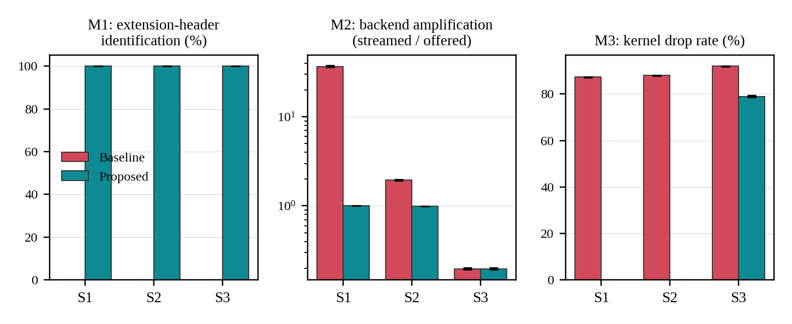
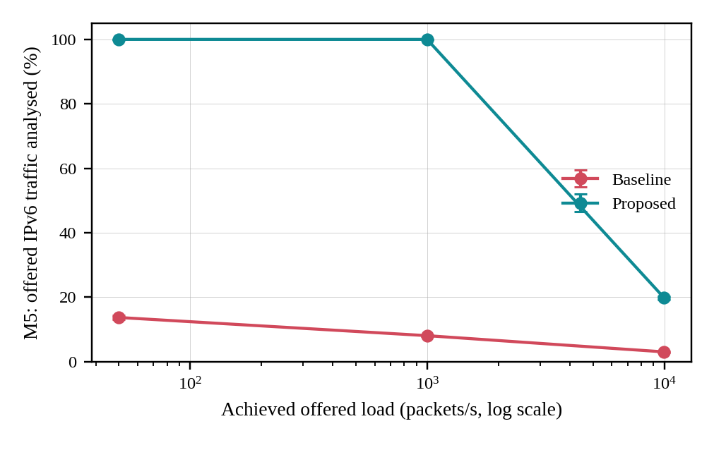

# NetPulse: Real-Time Network Packet Sniffer & Live Streaming Dashboard

**Computer Networks Lab Project — Slot F1, Team 22**

A full-stack network packet capture, DNS monitoring, and streaming system built with **C++ (libpcap & POSIX sockets)**, **Node.js / Express**, **Socket.io**, and a real-time web dashboard.

---

## Architecture Overview

```
                                      +---------------------------------------------+
                                      |            Browser Web Dashboard            |
                                      |          http://localhost:3000              |
                                      +---------------------------------------------+
                                                             ▲
                                                             | WebSocket (Socket.io)
                                                             ▼
                                      +---------------------------------------------+
                                      |          Node.js & Express Backend          |
                                      |          (port 3000, Morgan logging)        |
                                      |    Endpoints: /api/packets, /api/dns        |
                                      +---------------------------------------------+
                                                ▲                        ▲
                         HTTP POST /api/packets |                        | HTTP POST /api/dns
                                                |                        |
+------------------------------+  +--------------------------+  +--------------------------+
|  F1_Team22_sniffer (CLI)     |  | F1_Team22_sniffer_http   |  | F1_Team22_dns_server    |
| Terminal packet analyzer     |  | Real-time HTTP streamer  |  | UDP Port 53 Forwarder    |
| libpcap promiscuous capture  |  | libpcap promiscuous      |  | Forwards to 8.8.8.8      |
+------------------------------+  +--------------------------+  +--------------------------+
              ▲                               ▲                                ▲
              +---------------+---------------+                                |
                              |                                                |
                 Raw Network Interfaces                               UDP DNS Queries
                 (eth0, wlan0, lo, any)                               (Port 53 Client)
```

---

## Features & Implementation Details

1. **IPv6 Hop-by-Hop / "Proto 0" Bug Resolution**:
   - **Problem**: Capturing IPv6 packets caused many packets to be misidentified as `Proto 0` / `Protocol 0`. In IPv6, Protocol 0 is `IPPROTO_HOPOPTS` (Hop-by-Hop Options), which prefixes Multicast Listener Discovery (MLD), Router Alert, and Neighbor Discovery traffic.
   - **Solution**: Built an IPv6 extension header traversal engine that walks through Hop-by-Hop (0), Routing (43), Fragment (44), Destination Options (60), Authentication Headers (51), and Mobility (135) to accurately reveal the underlying transport/payload protocol (e.g., `ICMPv6 (MLDv2 Report)`, `ICMPv6 (Neighbor Solicitation)`, `TCP`, `UDP`) and parses TCP/UDP ports.

2. **Multi-Link-Layer (DLT) Support for Linux Cooked Capture (`any`)**:
   - Added native support for `DLT_EN10MB` (standard Ethernet on `eth0`), `DLT_LINUX_SLL` (Linux cooked capture v1 on interface `any`), `DLT_LINUX_SLL2`, and `DLT_NULL`/`DLT_LOOP` (loopback).
   - Both `sniffer` and `sniffer_http` now run on any interface (`eth0`, `any`, `lo`, `wlan0`).

3. **C++ UDP DNS Forwarding Server (`F1_Team22_dns_server`)**:
   - Binds to UDP port 53 using standard POSIX sockets (`cap_net_bind_service`).
   - Parses RFC 1035 wire-format DNS queries, extracts requested domain names, forwards queries to upstream resolvers (`8.8.8.8:53`), and relays responses back to clients.
   - Asynchronously transmits query metadata via HTTP POST to `/api/dns` for live dashboard analytics.

4. **Self-Capture Loop Prevention**:
   - Automatically installs a kernel-level BPF filter (`not (tcp port 3000)`) and enforces user-space port checks in `sniffer_http` so sending HTTP POST requests to port 3000 never triggers recursive self-capture storms.

5. **Permission & Capability Configuration**:
   - Applied Linux capabilities `cap_net_raw,cap_net_admin=eip` to `sniffer` and `sniffer_http`, and `cap_net_bind_service=+ep` to `dns_server`.
   - All binaries can run securely without full root privileges.

6. **Enhanced Protocol & Transport Decoders**:
   - Decodes IPv4 and IPv6 packets.
   - **TCP**: Decodes source/destination ports, TCP flags (`SYN`, `ACK`, `FIN`, `RST`, `PSH`, `URG`), sequence numbers, and service names.
   - **UDP**: Decodes ports and known services (`DNS`, `DHCP`, `NTP`, `mDNS`, etc.).
   - **ICMP / ICMPv6**: Decodes message types (Echo Request/Reply, MLD, Neighbor Solicitations, etc.).
   - **ARP**: Decodes ARP Requests and Replies with sender/target IPs and MACs.

7. **Real-Time Web Dashboard**:
   - Responsive UI with sticky navigation header, live scrolling packet inspection table, protocol distribution charts, packet search/filtering, and real-time DNS queries monitor.

---

## Empirical Evaluation & Results

To objectively evaluate NetPulse's improvements, we conducted rigorous benchmark experiments comparing our proposed implementation against a naive baseline sniffer under varying traffic loads.

Full documentation and methodology: [`results.md`](results.md) (or [`F1_Team22_results.md`](F1_Team22_results.md)).
Experiment code and raw logs: [`experiments/`](experiments/).

### Key Experimental Findings (30 Benchmark Trials)

| Scenario | Metric | Baseline | Proposed (NetPulse) | Improvement |
|---|---|---|---|---|
| **S1 (50 pkt/s)** | M1: IPv6 Ext-Header Accuracy (%) | 0.0 ± 0.0 | **100.0 ± 0.0** | **+100.0 pp** |
| S1 (50 pkt/s) | M2: Backend Amplification Factor | 36.80 ± 0.70 | **1.00 ± 0.00** | **97.3% lower (Loop eliminated)** |
| S1 (50 pkt/s) | M3: Kernel Drop Rate (%) | 87.25 ± 0.04 | **0.00 ± 0.00** | **100.0% lower** |
| S1 (50 pkt/s) | M5: Traffic Coverage (%) | 13.7 ± 0.7 | **100.0 ± 0.0** | **+86.3 pp** |
| **S2 (1,000 pkt/s)** | M1: IPv6 Ext-Header Accuracy (%) | 0.0 ± 0.0 | **100.0 ± 0.0** | **+100.0 pp** |
| S2 (1,000 pkt/s) | M2: Backend Amplification Factor | 1.95 ± 0.02 | **1.00 ± 0.00** | **48.8% lower** |
| S2 (1,000 pkt/s) | M3: Kernel Drop Rate (%) | 87.98 ± 0.09 | **0.00 ± 0.00** | **100.0% lower** |
| S2 (1,000 pkt/s) | M5: Traffic Coverage (%) | 8.1 ± 0.1 | **100.0 ± 0.0** | **+91.9 pp** |
| **S3 (10,000 pkt/s)**| M1: IPv6 Ext-Header Accuracy (%) | 0.0 ± 0.0 | **100.0 ± 0.0** | **+100.0 pp** |
| S3 (10,000 pkt/s)| M3: Kernel Drop Rate (%) | 91.98 ± 0.05 | **78.98 ± 0.32** | **14.1% lower** |
| S3 (10,000 pkt/s)| M5: Traffic Coverage (%) | 3.1 ± 0.2 | **19.8 ± 0.5** | **+16.8 pp** |

### Performance Visualizations





### Reproducing the Experiments

```bash
cd experiments
sudo ./run_all.sh       # or sudo ./F1_Team22_run_all.sh
```

---

## Quick Start

### 1. Build the C++ Binaries
```bash
make clean && make
```
*Compiles `F1_Team22_sniffer.cpp`, `F1_Team22_sniffer_http.cpp`, and `F1_Team22_dns_server.cpp` into executables (`sniffer`, `sniffer_http`, `dns_server` and their `F1_Team22_*` aliases), and assigns Linux capabilities (`cap_net_raw`, `cap_net_admin`, `cap_net_bind_service`).*

You can also explicitly invoke:
```bash
make -f F1_Team22_Makefile
```

### 2. Run All Services (Recommended)
You can manage the complete stack with the provided service scripts:
```bash
# Start backend, sniffer, and DNS server:
./F1_Team22_start.sh    # or ./start.sh

# Check status and live stats:
./F1_Team22_status.sh   # or ./status.sh

# Stop all services:
./F1_Team22_stop.sh     # or ./stop.sh
```
*Open http://localhost:3000 in your browser to view the live dashboard.*

---

### Manual / CLI Execution

#### Start the Web Dashboard Backend
```bash
cd packet-streamer
npm start
# or: node F1_Team22_server.js
```

#### Stream Live Packets to Dashboard
In another terminal:
```bash
# Stream traffic across all interfaces:
./sniffer_http -i any -p 3000
# or:
./F1_Team22_sniffer_http -i any -p 3000

# Or listen specifically on eth0:
./sniffer_http -i eth0 -p 3000
```

#### Run the DNS Forwarding Server
```bash
./dns_server -p 53 -u 8.8.8.8 --backend-host 127.0.0.1 --backend-port 3000
# or:
./F1_Team22_dns_server -p 53 -u 8.8.8.8 --backend-host 127.0.0.1 --backend-port 3000
```

#### Standalone CLI Packet Sniffing (Without Web Dashboard)
```bash
# Capture on eth0:
./sniffer -i eth0

# Capture with BPF filter (e.g. TCP only):
./sniffer -i eth0 -f "tcp"

# Capture 20 packets with verbose payload hex dump:
./sniffer -i eth0 -c 20 -v
```

---

## Project Structure

```
Network-Traffic-Analyzer/
├── F1_Team22_sniffer.cpp              # Standalone terminal packet sniffer (libpcap, BPF, hex dump)
├── F1_Team22_sniffer_http.cpp         # Real-time packet streamer delivering packets via HTTP POST
├── F1_Team22_dns_server.cpp           # UDP DNS forwarder listening on port 53 streaming queries
├── F1_Team22_Makefile                 # Primary Makefile with capability configuration
├── Makefile                           # Default Makefile including F1_Team22_Makefile
├── F1_Team22_start.sh / start.sh      # Service startup script
├── F1_Team22_status.sh / status.sh    # Service status inspection script
├── F1_Team22_stop.sh / stop.sh        # Service termination script
├── results.md                         # Comprehensive experimental evaluation and methodology
├── F1_Team22_results.md               # Prefixed evaluation report
├── F1_Team22_NetPulse_CN_Lab_Presentation.pptx # Project presentation slide deck
├── F1_Team22_NetPulse_CN_Lab_Project_Report.pdf # Formal academic lab report
├── F1_Team22_DASHBOARD_SCREENSHOTS_captioned.pdf # Captioned UI screenshots
├── experiments/                       # NetPulse empirical evaluation suite
│   ├── README.md                      # Experiment instructions and reproduction details
│   ├── gen_pool.py                    # Synthetic packet pool generator (2,000 mixed packets)
│   ├── build_variants.py              # Builds measurement variants (proposed, baseline, ethonly)
│   ├── run_exp.py                     # Trial runner with tcpreplay and live scoring
│   ├── run_aux.py                     # Auxiliary cooked-frame and fragment verification
│   ├── analyze.py                     # Statistics aggregator and chart generator
│   ├── run_all.sh / F1_Team22_run_all.sh # Master experiment execution pipeline
│   ├── send_v6_demo.py                # Live demo helper script
│   └── results/                       # Generated benchmark results, charts, and raw datasets
│       ├── RESULTS.md                 # Detailed experiment report
│       ├── fig4_metrics.png           # Accuracy, amplification, drop rate bar charts
│       ├── fig5_coverage.png          # Traffic coverage vs. offered load curve
│       ├── results_raw.csv            # Per-run counters in CSV format
│       ├── results.jsonl              # Raw JSONL trial logs
│       ├── summary.json               # Aggregated mean & standard deviations
│       ├── aux_results.json           # Auxiliary verification check data
│       └── ground_truth_check.json    # tcpdump ground truth verification
├── packet-streamer/                   # Node.js Express & Socket.io dashboard backend
│   ├── F1_Team22_server.js            # Express API backend with Socket.io broadcaster
│   ├── server.js                      # Backward-compatible server entry point
│   ├── F1_Team22_simulate_packets.py  # Test packet generator for offline demonstration
│   ├── simulate_packets.py            # Wrapper for packet simulator
│   ├── F1_Team22_test_socket.js       # Automated Socket.io integration test script
│   ├── test_socket.js                 # Wrapper for Socket.io test script
│   ├── package.json                   # Node.js project manifest
│   └── public/                        # Frontend dashboard web interface
│       ├── index.html                 # Real-time responsive HTML/JS web dashboard
│       └── F1_Team22_index.html       # Prefixed web dashboard template
└── systemd/                           # Linux systemd service definitions
    ├── packet-dns.service / F1_Team22_packet-dns.service
    ├── packet-sniffer.service / F1_Team22_packet-sniffer.service
    └── packet-streamer.service / F1_Team22_packet-streamer.service
```
